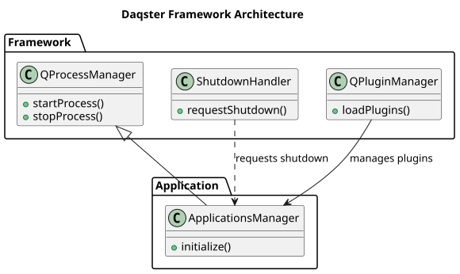
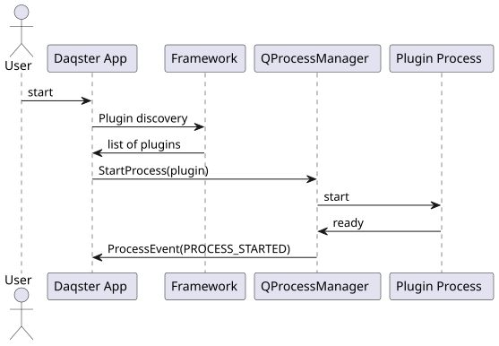
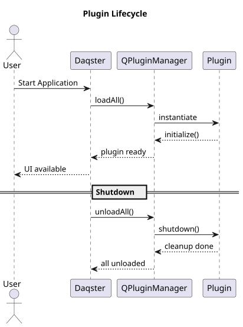

# Архитектура на Daqster

[Български](./README.md) | [English](./README.en.md)

Родител: [Documentation Index](../index.md)

## Архитектурен хъб

- [BuildSystemArchitecture.md](./BuildSystemArchitecture.md) - build архитектура и зависимости
- [core-gui-split.md](./core-gui-split.md) - разделяне model (core) / widgets (gui)
- [node_editor/README.md](./node_editor/README.md) - Node Editor подсистема (QtNodes, IDE, нодове, ADR-и)
- [rest-api-remote-control.md](./rest-api-remote-control.md) - REST + WebSocket контролна плоскост
- [capabilities.md](./capabilities.md) - capability интерфейси (договори host ↔ plugin)
- [runtime-mode-architecture.md](./runtime-mode-architecture.md) - (исторически) runtime режими
- [apps/README.md](./apps/README.md) - application подсистема
- [framework/README.md](./framework/README.md) - framework подсистема
- [plugins/README.md](./plugins/README.md) - plugin подсистема

## Свързани секции

- [Development Topics](../development/README.md) - workflow за разработка и дебъг материали

## Общ преглед

Daqster е Qt-базирана рамка за създаване и зареждане на плъгини с хост приложение (Qt6 е основната/preferred версия, Qt5 е compat). Проектът използва модулна архитектура, която позволява лесно разширяване чрез динамично зареждане на плъгини.

## Структура на проекта

```
Daqster/
├── src/                          # Source код
│   ├── frame_work/               # Ядро на рамката (target: FrameworkCore; QtWidgets част: FrameworkGui)
│   │   ├── base/src/             # Implementation (QPluginManager, QPluginInterface, control/, engine/, ...)
│   │   │   └── include/          # Headers
│   │   └── (виж docs/Architecture/core-gui-split.md)
│   ├── apps/                     # Приложения
│   │   ├── Daqster/              # Главното GUI приложение (ApplicationsManager, AppToolbar)
│   │   └── NodeRunner/           # Двоен режим: GUI или `--headless` (споделен AppBootstrap)
│   └── plugins/                  # ВСИЧКО график/AI живее тук
│       ├── external_libs/        # Git submodules (nodeeditor → QtNodesCore/QtNodes, qtrest_lib)
│       ├── common/               # DaqsterCommonLibrary (target) + capability интерфейси
│       │   ├── capabilities/     # INodeProvider, IWidgetProvider, INodeConfigSchema, IRuntimeHost, ...
│       │   └── NodeDataTypes/    # VideoFrameData, SampledData, EmbeddingData, ...
│       ├── node_editor/          # ← група: всичко около node editor-а
│       │   ├── node_editor_ide/  # IDE shell (NodeEditorIde) + NodeSupport (libNodeEditorLibrary.so)
│       │   └── nodeditor_nodes/  # {core,gui} — INodeProvider / IWidgetProvider доставчик
│       ├── runtime_host/         # {headless,gui} — runtime host плъгини (IRuntimeHost)
│       ├── qt_coin_trader/       # QtCoinTrader плъгин
│       ├── requirements_manager/ # Requirements Manager (RDD UI) плъгин
│       └── tests/                # Тестови плъгини
├── scripts/                      # Dev/build скриптове
│   ├── build.sh                  # Configure+build (qt5|qt6)
│   ├── version.sh                # Синхронизира VERSION навсякъде
│   └── suggest_version.sh        # Предлага следваща версия (semver от VERSION + git)
├── tools/                        # Инструменти за билд/измерване
│   ├── create_appimage.sh        # AppImage създаване
│   ├── measure_flow_memory.sh    # Измерване на RSS по .flow сценарий
│   └── Build_AppImage/           # Локални AppImage билдове
├── docs/                         # Документация
│   ├── Architecture/             # Архитектурна документация
│   │   ├── README.md             # Този файл
│   │   ├── README.en.md          # English версия
│   │   ├── BuildSystemArchitecture.md
│   │   ├── core-gui-split.md     # model (core) / widgets (gui) разделяне
│   │   ├── capabilities.md       # capability интерфейси
│   │   ├── rest-api-remote-control.md
│   │   ├── node_editor/          # Node Editor подсистема (README.md, nodes.md, adr/)
│   │   ├── apps/
│   │   ├── framework/
│   │   └── plugins/
│   ├── development/              # Разработка и дебъг (DeveloperGuide, HowToDebugAppImage)
│   ├── operations/               # Оперативни и build теми (+ ReleaseVersioning.md)
│   ├── plugins/                  # Per-plugin README-та (node_editor_ide, nodeditor_nodes, qt_coin_trader)
│   └── porting/                  # Портинг и миграции (QtRest Qt6)
├── .github/workflows/            # CI/CD
│   ├── ci.yml                    # Continuous Integration (Qt6 primary)
│   ├── release.yml               # Release workflow
│   ├── version-sync.yml          # Version sync check
│   ├── render-plantuml.yml       # PlantUML diagram rendering
│   └── pages.yml.disabled        # GitHub Pages (disabled)
└── CMakeLists.txt                # Главен CMake файл
```

## Основни компоненти

### 1. Frame Work (Ядро)

**Местоположение:** `src/frame_work/base/`

**Основни класове:**
- `QPluginManager` - Управление на плъгини
- `QPluginInterface` - Базов интерфейс за плъгини
- `QPluginLoaderExt` - Разширено зареждане на плъгини
- `PluginFilter` - Филтриране на плъгини

**Отговорности:**
- Откриване на плъгини в различни директории
- Зареждане и инициализиране на плъгини
- Управление на жизнения цикъл на плъгини
- Филтриране по тип и свойства

### 2. Host Application (Главно приложение)

**Местоположение:** `src/apps/Daqster/` (GUI host) и `src/apps/NodeRunner/` (двоен режим)

**Основни класове (`Daqster`):**
- `main.cpp` - Точка на влизане
- `ApplicationsManager` - Управление на child приложения
- `AppToolbar` - GUI toolbar за стартиране на плъгини

**`NodeRunner`** — един изпълним файл с два режима: GUI (по подразбиране) или
`--headless`. Споделящата bootstrap логика живее в widget-free `AppBootstrap`
(REQ-SW-PL-048), за да не се дублира между `Daqster` и `NodeRunner`. Подробно:
[apps/NodeRunner.md](./apps/NodeRunner.md).

**Отговорности:**
- Инициализиране на Qt приложението
- Зареждане на плъгини при стартиране
- Стартиране на плъгини като отделни процеси
- Управление на GUI елементи

### 3. Plugin System (Система за плъгини)

**Местоположение:** `src/plugins/`

**Типове плъгини** (от `PluginDescription::PLUGIN_TYPE_NAME`):
- **APPLICATION_PLUGIN** — самостоятелни приложения (QtCoinTrader, RequirementsManager)
- **Node Provider** — `INodeProvider` доставчик на нодове (nodeditor_nodes `core`)
- **Widget Provider** — `IWidgetProvider` (node_editor_ide, nodeditor_nodes `gui`)
- **Runtime Host** — `IRuntimeHost` (runtime_host `headless`/`gui`)

Всеки плъгин може да има **`core`** (headless, widget-free) и **`gui`** (QtWidgets)
половина — виж [core-gui-split](core-gui-split.md). Договорите са в
[capabilities](capabilities.md).

**Plugin Discovery:**
1. Build директория (`./plugins`, `../lib/daqster/plugins`)
2. Environment variables (`DAQSTER_PLUGIN_DIR`, `DAQSTER_PLUGIN_PATH`)
3. User plugins (`~/.local/share/daqster/plugins`)
4. System plugins (`/usr/lib/daqster/plugins`)

**Capability Discovery:**
- `QPluginManager::instances(IID)` — открива плъгини по capability интерфейс
- `INodeProvider_IID` — нод доставчици
- Класификация идва от `PluginDescription::PLUGIN_TYPE_NAME`

### 4. External Libraries (Външни библиотеки)

**Местоположение:** `src/plugins/external_libs/`

**Библиотеки:**
- **nodeeditor** — Граф редактор за нодове (submodule) → **`QtNodesCore`** (model-only, QtCore+QtGui, без QtWidgets) + **`QtNodes`** (QtWidgets canvas, линква QtNodesCore)
- **qtrest_lib** — REST API клиент (submodule + wrapper)

### 5. Capabilities (Споделени интерфейси)

**Местоположение:** `src/plugins/common/capabilities/`

Header-only интерфейси (договори host ↔ plugin), достъпни за всеки плъгин. Пълният
каталог: [capabilities](capabilities.md). Ключови:

- **INodeProvider.h** — доставка на `NodeDelegateModel` типове към node editor-а
- **IWidgetProvider.h** — доставка на `QWidget`-и (конфигурация/дисплей) за GUI режим
- **INodeConfigSchema.h** — widget-free описание на конфигурацията на нод (и в headless)
- **IRuntimeHost.h** — договор за runtime host плъгините
- **IStartable.h / IStoppable.h** — стартиране/спиране на нодове (напр. `Start`/`Stop` в GUI)

```cpp
class INodeProvider {
public:
    virtual ~INodeProvider() = default;
    virtual void registerNodes(NodeDelegateModelRegistry& registry) const = 0;
};
```

## Архитектурни принципи

### 1. Модулност
- Всеки компонент е независим модул
- Ясно разделение на отговорности
- Лесно тестване и поддръжка

### 2. Разширяемост
- Динамично зареждане на плъгини
- Plugin discovery система
- Поддръжка за различни типове плъгини

### 3. Изолиране
- Плъгини се стартират като отделни процеси
- Environment variables за изолация
- Независими конфигурационни файлове

### 4. Крос-платформеност
- Qt6 за GUI и крос-платформеност (Qt5 като compat fallback)
- CMake за build система
- AppImage за Linux разпространение

## Data Flow

### 1. Стартиране на приложението
```
main.cpp
├── Инициализира QApplication
├── Създава QPluginManager
├── Зарежда плъгини
└── Стартира GUI
```

### 2. Зареждане на плъгини
```
QPluginManager
├── Сканира директории за плъгини
├── Зарежда .so файлове
├── Инициализира QPluginInterface
└── Добавя в списък с активни плъгини
```

### 3. Стартиране на плъгин
```
AppToolbar/ApplicationsManager
├── Получава заявка за стартиране
├── Намира плъгин по име
├── Създава QProcess с environment
└── Стартира като child процес
```

## Архитектурна диаграма



[PlantUML източник](../diagrams/architecture.puml)

## Plugin Discovery Flow



[PlantUML източник](../diagrams/startup_sequence.puml)

## Environment Variables

### Plugin Discovery
- `DAQSTER_PLUGIN_DIR` - Една директория за плъгини
- `DAQSTER_PLUGIN_PATH` - Множество директории (разделени с `:`)

### Qt Environment
- `LD_LIBRARY_PATH` - Пътища към споделени библиотеки
- `QML2_IMPORT_PATH` - Пътища към QML модули
- `QT_PLUGIN_PATH` - Пътища към Qt плъгини
- `QT_QPA_PLATFORM_PLUGIN_PATH` - Пътища към platform плъгини

### XDG Directories
- `XDG_CONFIG_HOME` - Конфигурационни файлове
- `XDG_DATA_HOME` - Данни
- `XDG_CACHE_HOME` - Кеш

## Security Considerations

### 1. Plugin Isolation
- Плъгини се стартират като отделни процеси
- Ограничен достъп до системни ресурси
- Environment variables за изолация

### 2. Plugin Validation
- Проверка на plugin metadata
- Валидация на plugin интерфейси
- Hash-based дедупликация

### 3. File System Access
- Ограничен достъп до файловата система
- XDG directories за user data
- Read-only AppImage среда

## Performance Considerations

### 1. Plugin Loading
- Lazy loading на плъгини
- Кеширане на plugin metadata
- Hash-based дедупликация

### 2. Memory Management
- RAII за автоматично управление на паметта
- Smart pointers за shared ресурси
- Правилно освобождаване на Qt обекти

### 3. Process Management
- Ефективно стартиране на child процеси
- Правилно управление на environment variables
- Graceful shutdown на процеси

## Testing Strategy

### 1. Unit Tests
- Тестване на отделни компоненти
- Mock обекти за изолация
- Automated test execution

### 2. Integration Tests
- Тестване на plugin зареждане
- Тестване на plugin стартиране
- End-to-end тестове

### 3. AppImage Tests
- Тестване на AppImage функционалност
- Тестване на environment variables
- Cross-platform compatibility

## 9. Plugin Lifecycle Diagram



[PlantUML източник](../diagrams/plugin_lifecycle.puml)

## 10. AppImage Structure

```
Daqster-x86_64.AppImage
├── AppRun                          ← startup script
├── daqster.desktop
├── daqster.png
└── usr/
    ├── bin/
    │   └── Daqster                 ← главен изпълним файл
    ├── lib/
    │   ├── libQt*.so.*             ← Qt библиотеки
    │   ├── libicu*.so.*            ← ICU библиотеки
    │   ├── plugins/                ← Qt плъгини
    │   ├── qml/                    ← QML модули
    │   └── daqster/
    │       └── plugins/            ← Daqster плъгини
    └── share/
        ├── applications/           ← .desktop файл
        └── icons/                  ← икона
```

**AppRun настройва environment при стартиране:**

| Променлива | Стойност |
|---|---|
| `LD_LIBRARY_PATH` | `usr/lib/` |
| `QT_PLUGIN_PATH` | `usr/lib/plugins/` |
| `QML2_IMPORT_PATH` | `usr/lib/qml/` |
| `DAQSTER_PLUGIN_DIR` | `usr/lib/daqster/plugins/` |
| `XDG_CONFIG_HOME` | `~/.config/daqster` |


## 11. Future Enhancements

### 1. Plugin Management
- GUI за управление на плъгини
- Plugin marketplace
- Автоматично обновяване на плъгини

### 2. Performance
- Plugin preloading
- Memory optimization
- Startup time improvement

### 3. Security
- Plugin sandboxing
- Code signing
- Permission system

## Заключение

Daqster използва модулна архитектура, която позволява лесно разширяване и поддръжка. Системата за плъгини е проектирана да бъде безопасна, ефективна и лесна за използване. Build системата поддържа както локална разработка, така и CI/CD за автоматизирано разпространение.
